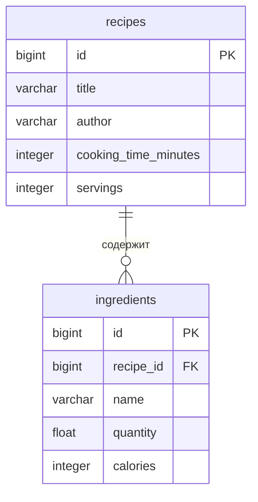

# Backend: Книга рецептов

Тема №15: Книга рецептов. REST API сервис, который представляет собой цифровую кулинарную книгу. Он позволяет удобно создавать, хранить, структурировать и искать рецепты любимых блюд.

| | |
| --- | --- |
| Главная сущность | Рецепт(Recipe) |
| Связанная сущность (1:N) | Ингредиент(Ingredient) |
| Фишка | ... |
| Стек | Java 27, Spring Boot 4, Spring Web MVC, Hibernate Validator, Springdoc OpenAPI 3.1.0, Maven |

## Как запустить

```bash
# 1. Клонировать репозиторий
git clone https://github.com/Nira1y/backend_project.git
cd backend_project
cd backend
# 2. Запустить сервер (macOS/Linux)
chmod +x mvnw
./mvnw spring-boot:run
# 2.1 Для Windows(PowerShell)
.\mvnw.cmd spring-boot:run 
(Если при запуске на Windows возникает ошибка пути, можно использовать установленный Maven: mvn spring-boot:run)
``` 
Сервис работает на `http://localhost:8080`. Запросы для демонстрации лежат в `requests.http`.

## Эндпоинты
### Рецепты (главная сущность)
| Метод | Путь | Что делает | Ответ |
| --- | --- | --- | --- |
| GET | `/health` | Проверка, что сервис жив | 200 `{"status":"ok"}` |
| POST | `/api/recipes` | Создать рецепт | 201 и объект с `id`; 400 при ошибке |
| GET | `/api/recipes` | Список рецептов (с пагинацией и фильтром) | 200 |
| GET | `/api/recipes/{id}` | Получить один рецепт | 200; 404 |
| PATCH | `/api/recipes/{id}` | Изменить рецепт | 200; 400; 404 |
| DELETE | `/api/recipes/{id}` | Удалить рецепт | 204; 404 |

### Ингредиенты (связанная сущность, вложенный маршрут)
| Метод | Путь | Что делает | Ответ |
| --- | --- | --- | --- |
| POST | `/api/recipes/{recipeId}/ingredients` | Добавить ингредиент к рецепту | 201 и объект с `id`; 400; 404; 409 (дубликат) |
| GET | `/api/recipes/{recipeId}/ingredients` | Получить список ингредиентов рецепта | 200; 404 |

## ER-диаграмма

<!-- С лабы 2. Блок mermaid GitHub рисует сам. -->


## Индекс
Создан индекс `idx_recipes_title_lower` на поле `title` без учета регистра (создается миграцией Flyway `V4__create_index.sql`).

Запрос:
```sql
EXPLAIN ANALYZE SELECT * FROM recipes WHERE LOWER(title) = 'борщ';
```
Вывод:
```text
 Index Scan using idx_recipes_title_lower on recipes  (cost=0.13..8.15 rows=1 width=1048) (actual time=0.070..0.070 rows=1.00 loops=1)
   Index Cond: (lower((title)::text) = 'борщ'::text)
   Index Searches: 1
   Buffers: shared hit=1 read=1
 Planning:
   Buffers: shared hit=8
 Planning Time: 0.105 ms
 Execution Time: 0.098 ms
(8 rows)
```
## Интерфейс

<!-- С лабы 4: скриншот, например  -->
